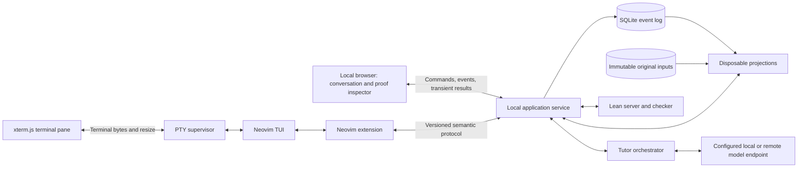

# LearnLean: MVP technical design

## Decisions and scope

This is a design, not an implementation report. Build a local browser application whose primary interface is a rich conversation with an LLM tutor. The tutor selects or proposes teaching material, while the learner edits the active assignment in a real Neovim terminal and inspects Lean results beside it.

The executable product is a Nix flake. It launches one local application service, a PTY running Neovim, and Lean processes. SQLite stores the event log. There is no hosted backend, database server, account system, container runtime, or multi-user execution boundary in the MVP.

Trust the local operator and their chosen tools. Security-boundary engineering, process sandboxing, tenancy, and deployment hardening are deferred. Cancellation, timeouts, clear process ownership, and recovery remain necessary for a usable application. Mathematical validation also remains necessary: trusting the operator does not make an incomplete proof complete.

## Reference: what to take from MathPub

The inspected neighboring repository provides useful concrete precedents:

| Reference | Relevant pattern | LearnLean application |
| --- | --- | --- |
| [Agentic vision](../mathpub/AGENTIC_VISION.md) | Conversation operates real tools and reusable content | Tutor-directed learning with explicit material choices |
| [GUI design](../mathpub/GUI_DESIGN.md) | Terminal beside a synchronized visual surface | Neovim beside Lean goals and diagnostics |
| [PTY manager](../mathpub/src/mathpub/gui/terminal.py) | Process launch, PTY I/O, resize, lifecycle | Inform the local terminal supervisor |
| [Workspace frontend](../mathpub/src/mathpub/gui/static/app.js) | xterm rendering and bidirectional terminal transport | Inform terminal focus, resize, and reconnect behavior |
| [Component lexicon](../mathpub/COMPONENT_LEXICON_DESIGN.md) | Stable material identities linked to concepts | Small reusable teaching catalog |
| [Nix flake](../mathpub/flake.nix) | Packaged workspace and pinned tool environment | One reproducible local launch entry point |

These are local inspection references, not a dependency on `../mathpub` at runtime. Reuse design patterns first; extract actual code only after checking dependencies and licensing. Do not copy MathPub's PDF-specific machinery, inject tutor edits as terminal keystrokes, or adopt persisted calculated validation manifests.

## Architecture



Start with TypeScript/React for the rich UI and TypeScript/Node.js for the local service, using a packaged PTY library, SQLite binding, and Neovim RPC client. Pin all dependencies through the flake and language lockfiles. These are proposed choices to validate on macOS before expanding platform support.

The browser connects only to the local service. The service owns process lifecycles and the event-log writer. Its HTTP/WebSocket channels carry domain commands and transient results; a separate terminal channel carries bytes and resize messages. The local service binds to loopback and launches the browser. A native wrapper is later work, not a condition for the first usable system.

The model adapter targets a configured remote provider or local endpoint. Local execution means the application, history, editor, and Lean run on the user's machine; it does not promise offline model inference. The UI identifies the selected endpoint. Model credentials/configuration stay outside session events and the Nix store.

## Nix packaging and launch contract

### Flake outputs

Proposed outputs, to be implemented later:

| Output | Purpose |
| --- | --- |
| `apps.<system>.default` / `apps.<system>.learnlean` | Launch local service, browser, and managed editor |
| `packages.<system>.learnlean` | Packaged application, frontend assets, bridge, and default materials |
| `packages.<system>.learnlean-neovim` | Pinned Neovim with the bundled integration configuration |
| `devShells.<system>.default` | Same runtime tools plus development/test dependencies |
| `checks.<system>.*` | Reducer, material, Lean, bridge, PTY, and packaged-launch checks |

Initial primary platform: `aarch64-darwin`. Target `aarch64-linux` and `x86_64-linux` through the same packaging contract after the first vertical slice. Do not claim support until packaged PTY and editor tests pass. Intel macOS and Windows are deferred.

Intended commands:

```console
nix run .#learnlean
nix run .#learnlean -- --session SESSION_ID
nix run .#learnlean -- --editor-profile personal
nix develop
nix flake check
```

These commands are a future interface; this repository remains design-only. Nix with flakes enabled is a prerequisite. First launch may fetch/build the closure; subsequent launches should reuse it. `nix run` launches the application, while `nix develop` is for development or deliberate tool access.

### What must be pinned

Commit `flake.nix`, `flake.lock`, frontend/backend dependency locks, and any Lean dependency manifest. The closure includes Lean and Lake, Neovim, the bridge, terminal assets/fonts, the service runtime, default editor plugins/configuration, and the material library. Choose a concrete compatible version set during the integration spike.

Use explicit store paths/wrapped executables for managed tools. Do not resolve Lean through an ambient `elan`, use the host `nvim` by accident, download editor plugins at startup, or run an unpinned `lake update`. Build required Lean dependencies through fixed source inputs before runtime. `lean-toolchain`, Lake metadata, and the actual launched Lean must agree.

Nix flakes use a lock file to identify dependency inputs; see the [Nix flake reference](https://github.com/NixOS/nix/blob/master/src/nix/flake.md). A lock is not a guarantee that upstream inputs remain available forever. Preserve input sources needed for sessions and keep a GC root for the runtime closure while those sessions are retained. Export/backup may include the closure or instructions and retained sources to rebuild it.

A session records the environment input identity: application/bridge version, lock-file bytes or immutable artifact reference, toolchain and material versions, and selected editor profile. Opening an older session should use its compatible retained runtime. If it is unavailable, restore source/chat and report rechecking unavailable rather than silently substituting tools. An upgrade creates an explicit new environment choice and invalidates derived checks.

User-configured Neovim is opt-in. Load the integration without rewriting the user's configuration, and show the actual executable/profile. A personal profile only has the full reproducibility guarantee when its configuration and dependencies are also supplied as pinned inputs. The bundled profile is the supported baseline. Nix does not pin the host browser, OS rendering, a mutable personal config, or a remote model's internal behavior.

## Material library and adaptive teaching

### Content objects

Use a compact declarative catalog, inspired by MathPub's component identities:

- `concept`: meaning, prerequisites, and learning objectives.
- `explanation` / `diagram`: reusable presentation tied to concepts.
- `worked-example`: statement, source, commentary, and hint/solution fragments.
- `exercise`: prompt, expected target type, starter source, reference solution, hints, and completion policy.
- `misconception`: recognizable difficulty and suggested teaching responses.

Each object has a stable ID, immutable version/hash, and original authored bytes. Presentation uses Markdown/math and declarative diagram components. There is no course-release aggregate or mandatory sequence. A session can use materials from a pinned library and later external tutor proposals; each actual presentation references the version it used.

Keep prompt and solution fragments separate so the tutor/UI can reveal them progressively. For a parameterized material, persist the original definition, chosen parameters/seed, and versioned instantiation rule; recompute expanded source, diagrams, and checks. Do not persist derived instance manifests containing results.

### Tutor initiative

The tutor receives the learner's stated intentions, recorded conversation, current assignment/source anchor, relevant library entries, and freshly derived Lean observations when available. It can:

1. Search/read material by concept, prerequisite, difficulty, or misconception.
2. Present a material or ask a diagnostic/reflection question.
3. Propose an exercise, including a reference solution for validation.
4. Inspect a proof position or check a candidate source.
5. Propose a patch to an existing assignment.
6. Suggest a next direction or return to an earlier topic.

The tutor can choose concepts and exercises without requiring an approval for every teaching turn. It cannot silently replace the current assignment's statement or mutate the learner's buffer. Opening the first assignment after a request to practice is automatic; replacing an active assignment normally waits for the learner's choice. A direct “give me another problem” request already authorizes that switch.

Choose the next teaching action after a learner message, submitted attempt, or explicit continuation request. Automatic Lean checks and cursor updates do not themselves trigger LLM turns. Limit each turn to a small number of tool calls and exercise-repair attempts; after two failed generated-exercise validations, offer a reviewed exercise or explain the limitation. Provider latency must not block the editor.

A generated exercise is stored as received external content: exact prompt, starter source, expected target, reference solution, and metadata. Validate that the reference solution proves the target under the pinned environment before activating it. Keep validation results disposable. The expected target is established for that assignment; a changed target is a different assignment. Lean validation establishes formal solvability, not prose accuracy or pedagogical suitability.

### Recorded choices versus calculated judgments

Record what actually happened: which material was presented, which assignment was opened, what the learner said, and the model content received. Do not persist a calculated learner model, readiness score, progress summary, or “mastered conjunction” event.

Model assessments remain historical utterances with evidence anchors, not authoritative facts. In-memory planning context can be rebuilt from the conversation and fresh checks. Replay restores the actual enacted path without calling the model to choose it again.

## Terminal and editor integration

### Two independent channels

Use xterm.js to render the PTY's output and forward keyboard input. Fit/resizing changes rows and columns in the PTY, causing Neovim to redraw. Reopening a hidden pane triggers a fresh fit. Terminal encoding, bracketed paste, Unicode, focus, and process exit must be covered by the integration spike. The [xterm.js terminal API](https://xtermjs.org/docs/api/terminal/classes/terminal/) and [addon guide](https://xtermjs.org/docs/guides/using-addons/) describe the frontend interfaces.

Launch the pinned Neovim TUI in the PTY with a local RPC socket, conceptually `nvim --listen <runtime-socket> <assignment-file>`. Do not use a headless editor or replace its rendering with a custom GUI. A bundled Lua extension communicates over Neovim's RPC connection with the application service.

Terminal bytes are not domain events. Do not scrape the status line, infer cursor positions from ANSI escapes, or send a model patch by typing commands into the PTY. Neovim's API exposes buffer updates and RPC facilities suitable for the semantic bridge; see the [Neovim API documentation](https://neovim.io/doc/user/api).

### Versioned editor adapter

The transport may be Neovim-specific, but the semantic contract must not be. Proposed protocol messages:

| Direction | Message | Contract |
| --- | --- | --- |
| Editor → app | `hello` | Protocol version, editor identity, supported capabilities |
| Editor → app | `buffer_attached` | Assignment ID, editor buffer generation, current text/tick |
| Editor → app | `buffer_changed` | Operation ID, acknowledged base revision, editor tick, original replacement text or full buffer input |
| Editor → app | `position_changed` | Assignment, tick, cursor/selection; ephemeral by default |
| Editor → app | `flush_complete` | All changes through a requested tick have been acknowledged |
| App → editor | `open_assignment` | Working file and recovered source revision |
| App → editor | `reveal_range` | Revision, range, and whether focus transfer was requested |
| App → editor | `apply_patch` | Operation ID, base revision, expected tick/hash, exact replacements |
| App → editor | `restore_source` | Reviewed target source with the same conflict checks |
| App → editor | `show_diagnostics` | Revision-scoped transient diagnostics |
| Either | `ack`, `conflict`, `capability_unavailable` | Explicit outcomes; no implicit success |

Use `nvim_buf_attach` callbacks to observe changes, plus cursor/buffer lifecycle hooks. Convert native Neovim byte-column positions to the protocol's declared coordinates. Start with UTF-8 byte offsets for canonical source and explicitly convert to Lean LSP positions and browser strings; test multibyte characters, emoji, and line endings. Neovim `changedtick`, protocol operation ID, source revision, and Lean document version are distinct identifiers.

The extension groups typing for a short debounce, serializes source submissions, and maintains an acknowledged base revision. On protocol gaps or reconnect, send the current full buffer as original editor input for reconciliation, rather than inventing missing patches. Cursor queries for an unacknowledged tick wait or show pending state; they cannot be labeled as inspecting the last acknowledged revision.

Capabilities include live buffers, cursor tracking, range reveal, undoable patch, and diagnostics. A terminal can run another editor without these capabilities. Saved-file fallback imports changed source when the file is written and provides checking; it does not promise live positions, unsaved updates, or programmatic patch application. A later adapter can add those capabilities without replacing chat, Lean, or the event store.

### Editor configuration and LSP ownership

The application service owns the Lean language-server document stream. It checks acknowledged source revisions and publishes results to both the browser inspector and the bridge. The bundled Neovim configuration does not start a competing Lean LSP client for managed assignment buffers. Completion/hover can later be forwarded through the same owner; they are not prerequisites for the first proof loop.

A personal profile must disable or coordinate any independently configured Lean client for those buffers. Report this compatibility issue as an integration state, not as a claim that personal configuration is pinned or supported automatically.

### Source files and durability

The event log is authoritative for acknowledged assignment text. Neovim works on real `.lean` files in a disposable session runtime workspace reconstructed from events. These are materialized working files, not a second durable source store. `:w` retains normal file-writing meaning; “Recorded” refers separately to event acknowledgement.

Runtime files and generated Lean artifacts may live on scratch disk, but are excluded from authoritative backups and must be removable without losing acknowledged work. They are caches, not calculated results intentionally retained as durable state. The bundled profile disables persistent swap/undo/shada for managed assignment buffers; within-process Neovim undo still works. User exports are explicit source artifacts, not automatic projection snapshots.

A watcher supports saved-file fallback and detects external edits. Writes made by the application's own materializer carry operation/hash bookkeeping to suppress echoes. If file, live buffer, and logged revision disagree, pause imports and offer an explicit choice; never overwrite a live dirty buffer during replay or a refresh. Surviving scratch files after a crash may be offered as unacknowledged recovery input, but are not silently promoted to authoritative history.

### Applying a reviewed patch

1. Flush the target buffer and obtain its acknowledged revision and current editor tick.
2. Verify that the proposal's base revision still matches. A mismatch asks for a refreshed proposal.
3. Send `apply_patch` with an operation ID, expected tick/hash, and exact replacements.
4. In one synchronous Lua operation, recheck the buffer tick and apply one undoable edit. Suppress per-line echo submissions for that transaction and emit one `buffer_changed` carrying the operation ID and resulting source input.
5. Append `SourceEdited` once, acknowledge it, and start a new Lean check. Only then display “Applied and recorded.”

If the editor changed but acknowledgement was lost, reconciliation compares the operation ID and text; it does not blindly apply the patch again. A failed append leaves the editor visibly “Not recorded.” Neovim undo/redo produces new source input events. Restoring source follows the same bridge transaction and never erases prior history.

## Lean integration

### Assignment model

Each assignment has its own ID, immutable original statement/environment, and versioned learner source. Use one managed file with a named target declaration per assignment in the MVP. The whole file can be inspected and edited in Neovim; validation detects changes that no longer meet the original task. No editor-locking or security enforcement is required to distinguish an altered statement from a completed assignment.

Check against pinned imports, expected target type, reference material, and completion policy. If the learner intentionally wants another theorem, create a new assignment in conversation. Assignments are independent; prerequisites supply authored definitions rather than mutable dependencies on earlier learner files.

### Interactive state

The service maintains one Lean server for the active environment and synchronizes acknowledged source into versioned documents, including unsaved Neovim content. Separate temporary documents handle proposal/reference-solution checks. Restart Lean and recreate its documents after a crash; never persist RPC handles.

Lean information trees and goal queries provide a starting point for proof-state inspection, but the exact tactic-boundary adapter must be prototyped against the pinned version. See [Lean's server information utilities](https://lean-lang.org/doc/api/Lean/Server/InfoUtils.html) and [widget request API](https://lean-lang.org/doc/api/Lean/Server/FileWorker/WidgetRequests.html).

Result identity includes `sessionId`, `assignmentId`, `sourceRevision`, `sourceHash`, `environmentId`, `adapterVersion`, `workerGeneration`, and `requestId`. Position results also include the selected range and before/after mode. Reject stale output by identity; cancellation alone is insufficient.

Derive meaningful steps from syntax/elaboration information, preserving nested branches and Lean goal order. Do not equate lines with tactics or infer proof structure by parsing printed goals. Unsupported macro interiors remain one composite step. A missing after-state is unavailable, not guessed. UI source maps account for any harness lines and Unicode conversions.

### Completion

A learner's Check action flushes the editor, appends `AttemptSubmitted` for the exact revision, and runs target verification. Continuous checks provide editing feedback; a submitted attempt is a deliberate checkpoint the tutor may discuss.

Verify successful elaboration of the expected target type, no unresolved metavariables, no `sorryAx` dependency, and only the assignment's declared allowed axioms. Lean tracks axiom dependencies; `sorry` uses `sorryAx`, as documented in the [Lean reference on axioms](https://lean-lang.org/doc/reference/latest/Axioms/). Checking axiom dependencies is proof validity, not an execution security boundary. Native-evaluation trust extensions, if ever allowed, require an explicit exercise policy rather than accidental acceptance.

Use structured target inspection against the pinned Lean API where feasible. Do not rely only on warning strings, a zero-goal selected state, or the model saying “correct.” Pedagogical constraints such as practicing a particular tactic are separate from logical validity.

“Completed earlier” can be derived from previously submitted revisions that still verify under their pinned environment. The current draft has an independent status. Recheck lazily after recovery; no durable completion badge or progress table is stored.

## Event-sourced core

### What is authoritative

Use a local SQLite database as an append-only event log, plus immutable original input artifacts. Transactions provide durable append acknowledgement, command deduplication, and stream sequencing. WAL is allowed: it is storage for the authoritative log, not a projection. The single service is the writer; no additional durable read database is needed.

Use one stream per learner session for the MVP. Events include an ID, stream sequence, schema version, command/operation ID, actor, recorded timestamp, and payload. Order by sequence, not wall-clock time. Source revisions are per assignment and assigned by the service.

```json
{
  "eventId": "opaque-id",
  "streamId": "session/opaque-id",
  "sequence": 42,
  "eventType": "SourceEdited",
  "schemaVersion": 1,
  "commandId": "editor-operation-id",
  "actor": { "kind": "learner" },
  "payload": {
    "assignmentId": "assignment-7",
    "baseRevision": 8,
    "revision": 9,
    "editorGeneration": "nvim-process-2",
    "bufferTick": 31,
    "sourceInput": "full original buffer text or validated replacement operations",
    "acceptedProposalId": "optional-proposal-id"
  }
}
```

Full buffer input received from an editor is an original source input, not a snapshot of the application aggregate. Hashes/IDs may index and verify original inputs; do not hide goals or grading results inside metadata.

### Durable event vocabulary

| Event | Main payload and meaning |
| --- | --- |
| `SessionStarted` | Initial learner intent, environment reference, settings choices |
| `LearnerMessageSubmitted` | Actual text and optional assignment/source/position anchor |
| `TutorTurnRequested` | Trigger, turn/attempt ID, model/prompt-policy version and input references |
| `TutorResponseReceived` | Actual received text, structured teaching actions, exercise/patch proposals, provider metadata |
| `MaterialPresented` | Enacted placement ID, received action reference, material version and original parameters |
| `AssignmentActivated` | New or existing assignment identity, exact original input references, activation intent |
| `SourceEdited` | Original editor/file input, base/new source revision, optional accepted proposal reference |
| `SourceRestored` | Restored original revision plus resulting new source revision/bridge operation |
| `AttemptSubmitted` | Exact acknowledged assignment revision to verify |
| `InspectionPositionChosen` | Deliberately pinned/navigated source anchor; ordinary cursor motion stays transient |
| `SolutionRevealRequested` | Explicit learner choice and solution reference |
| `TutorTurnCancelled` / `TutorRetryRequested` | Explicit control of model work and attempt IDs |
| `TutorRequestFailed` | Observed external provider failure, without secret-bearing payloads |
| `PreferenceChanged` / `EnvironmentSelected` | Original learner choices, including editor profile and pinned runtime |

A response may propose several actions, but only enacted actions produce presentation/activation events. These events capture historical actions, not claims of mathematical validity. Give each action a stable ID and append it at most once. `AssignmentActivated` references the original received/generated exercise or library inputs; it does not contain a stored validation result.

Within a tool-using turn, record each complete received model message or tool-call payload with a unique receipt ID before executing its action. A turn can therefore have several `TutorResponseReceived` events, distinguished as tool proposals or learner-visible responses. This preserves original exercise source even when it arrived as tool arguments rather than in the final chat text. Lean tool results remain transient; receipt deduplication and terminal turn status are separate from the number of messages received.

Do not append `ExerciseCompleted`, `LearnerMasteryUpdated`, `LeanCheckSucceeded`, `GoalsCalculated`, or persisted transcript-summary events. Current check statuses, inferred progress, and tutor planning summaries are projections.

### Storage classification

| Data | Rule |
| --- | --- |
| Learner source/messages, received model content, actual teaching actions | Durable events |
| Authored materials, templates, prompt policies, original model exercise proposals, lock/config source inputs | Durable original artifacts referenced by events |
| Received model-generated source and prose | External nondeterministic inputs; retain exact received content |
| Rendered transcript/cards, material search index, inferred learner model, expanded template instances | Recompute; memory caches only |
| Lean goals, diagnostics, eligibility, candidate checks, progress | Recompute; no durable result records |
| Terminal frames, RPC handles, cursor traffic, process leases | Transient runtime state |
| Neovim working files, virtual Lean files, compilation products | Disposable runtime scratch; never authoritative session backup |
| Nix packages, toolchain closures, dependency builds | Reproducible tool infrastructure; retain independently of learner-state projections |

A model reply is an external observation even if it discusses calculated goals. Recording the received utterance does not authorize persisting hidden Lean tool-result transcripts, generated learner profiles, or locally computed conversation summaries. Do not save full provider request dumps containing derived state. Reconstruct tool context from source/environment references when needed.

Nix build outputs are durable tool infrastructure by design. The prohibition on durable calculated application state concerns learner/session projections, not the Nix store itself. A flake closure is necessary to reproduce execution; a cached goal table is not.

## Replay, concurrency, and recovery

### Pure replay and later recomputation

Reducers fold versioned events and immutable original inputs without reading the current clock, network, editor, or model. Schema upcasters are deterministic. Input artifacts must be available and hash-verified. Replay restores actual conversation, presentations, assignments, source revisions, submissions, and explicit choices.

It does not restore computed Lean results, inferred understanding, a PTY process, or a previous Neovim undo tree. After replay:

1. Render the conversation and selected assignment with computed statuses unknown.
2. Materialize the working file and launch/connect Neovim from the pinned profile.
3. Start Lean and recheck the active source and selected proof position.
4. Revalidate relevant submissions and generated assignments on demand.
5. Reconcile interrupted model turns separately, without silently issuing a new request.

An assignment previously presented remains in historical chat even while revalidation is pending. That historical action is reproducible; its current “Ready/Checked” status is not inferred from the event name.

### Atomic appends and edit ordering

Commands carry a unique ID and expected session sequence; source operations also require the assignment base revision. Enforce uniqueness for event IDs, `(streamId, sequence)`, and `(streamId, commandId, eventOrdinal)`. Return the previous committed outcome for duplicate commands.

If a chat event advanced the session sequence without changing the buffer, retry the source append against the new sequence after validating the unchanged source revision. If source changed, reconcile explicitly. The MVP has one integrated editor process per session; a second process cannot silently become a concurrent source writer.

Only acknowledge “Recorded” after the SQLite transaction commits. Source input may be queued in the extension while typing continues, but checks and context-bearing chat requests wait for the appropriate flush barrier. Derived cache keys include reducer version and sequence; Lean keys also include source and environment identities.

### Model calls are not replay

Persist a turn request before contacting the endpoint. Transient leases prevent accidental live duplicate work. Record each completed received message before marking it saved and before enacting its actions; identify the final learner-visible response separately. Tokens may stream before that point with “Generating”; interrupted partial text is not guaranteed durable.

If the service crashes after a provider request but before recording the response, show “Interrupted; retry available.” Use provider retrieval/idempotency where supported; otherwise require explicit retry. Do not reissue a request during replay. Retry creates a new attempt ID; cancellation/late replies cannot replace the accepted response for another attempt.

If a recorded response's action was not enacted before a crash, show the recorded proposal. Resume may revalidate and enact that same pending action according to the original intent, or let the learner choose; it must not ask the model to invent another action. Stable action IDs prevent duplicate presentations and assignments.

### Persistence boundaries

Authoritative backups contain the SQLite event log, original artifact store, and environment retention references. Use SQLite's backup mechanism or a consistent closed/checkpointed copy, not an arbitrary copy of the live database file alone. Cache destruction is a routine recovery test.

Do not add durable aggregate snapshots, search indexes, completion tables, localStorage/IndexedDB transcript copies, or persisted Lean-result logs. Session selection can be reconstructed from events; endpoint credentials and launch settings are explicit local configuration inputs. Operational diagnostics should avoid becoming an accidental second source/chat/result store.

## Service interfaces

| Interface | Purpose |
| --- | --- |
| `POST /sessions` | Start a local session with initial choices |
| `POST /sessions/:id/commands` | Append an idempotent learner/editor/tutor action |
| `GET /sessions/:id/view` | Reconstructed view plus freshness metadata |
| `GET /sessions/:id/events?after=N` | Catch up committed event delivery |
| `WS /sessions/:id/live` | Committed events and distinctly typed transient check/token frames |
| `WS /sessions/:id/terminal` | PTY bytes, resize, terminal lifecycle |
| Local Neovim RPC socket | Structured editor bridge; separate from terminal transport |
| Material lookup / candidate check tools | Bounded tutor operations through the local service |

After reconnect, catch up events before accepting revision-scoped results. A dropped terminal frame is handled by reconnect/redraw, not by replaying terminal history. A live editor may continue running through a browser reload. Restarting the local service may require a fresh PTY/editor; recover acknowledged source first and reconcile any surviving process/buffer before opening a new writer.

## Local process lifecycle

The launcher creates a session runtime directory and owns its PTY, editor, and Lean children. Normal exit flushes pending editor input and stops children; a forced exit cannot promise recovery of unacknowledged keystrokes. On restart, detect stale sockets/processes before creating replacements.

Use cancellable checks, bounded tutor tool loops, and a visible Stop action so a long tactic or provider call cannot make the workspace unusable. Lean and Neovim run as ordinary local processes with the user's access. No container/sandbox, remote execution queue, policy approval layer, or multi-tenant scheduler is an MVP requirement.

## Validation and delivery gates

Proposed performance targets: immediate terminal response, buffer acknowledgement within 300 ms after a typing pause on a normal local workload, warm course-sized Lean checks within one second, and cached step navigation within 100 ms. Measure on the primary platform; cold Nix builds and model latency have separate visible states and are not part of warm-interaction targets.

| Gate | Deliverable | Exit condition |
| --- | --- | --- |
| 0. Pinned local launch | Flake starts browser, PTY Neovim, and Lean | Works without host Lean/Neovim/Node or database services |
| 1. Editor/Lean loop | Bridge streams unsaved edits and positions | Unicode mapping, resize, undo, before/after states, and stale-result handling pass |
| 2. Replayable workspace | SQLite events, recovered assignments, scratch materialization | Cache/runtime wipe recovers every acknowledged source revision |
| 3. Conversational teaching | Rich chat, library selection, generated-exercise validation | Two learner intentions produce coherent different paths; learner can redirect |
| 4. Reviewed changes and resume | Bridge patch transactions, interruption recovery, history | No duplicate patch, silent rebase, regenerated historical reply, or lost acknowledged edit |
| 5. Pilot | Small reusable catalog and usable packaging | Learning and interaction criteria in VISION.md can be evaluated |

Required implementation checks:

- Launch through the packaged flake on a clean environment with required tool names removed from ambient PATH; run tests in the same pinned development shell.
- Exercise Neovim Normal/Insert modes, `:w`, undo/redo, splits/buffer changes, resize, paste, bridge disconnect, and editor restart through a real PTY.
- Verify patch acceptance and stale rejection with edits arriving before, during, and after acknowledgement; crash after editor mutation but before event acknowledgement.
- Verify Unicode cursor/source maps and real Lean states for implication, conjunction, rewriting, multiline tactics, and induction branches.
- Reject false completion from `sorry`, an altered target, an unapproved axiom, or an unchecked tutor claim; keep such results disposable.
- Replay historical event schemas without external calls; wipe projections/runtime files and compare recovered original state, then recompute checks.
- Test model interruption before receipt, mid-stream, after receipt, and before action enactment; no silent rerun or duplicate material placement.
- Test adaptive flows with deterministic recorded model fixtures, then a small live-provider pilot. Test that unavailable model access leaves editing/checking usable.
- Test keyboard focus and accessible transcript/goals with the actual terminal combination; do not claim exact screenshot identity across host platforms.

The first technical risk is the source-revision contract across Neovim, SQLite, and Lean. The first product risk is whether the tutor's choices feel helpful and steerable. Validate both in a small local conversation before expanding the catalog or packaging a native shell.
