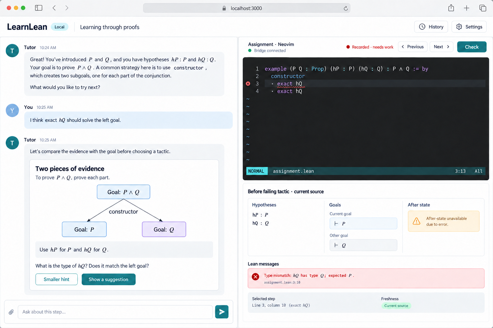
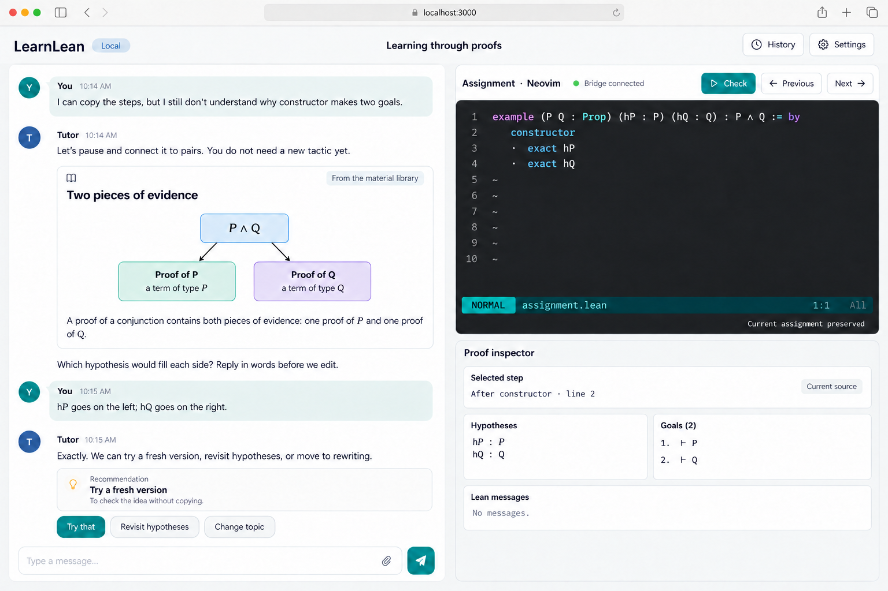
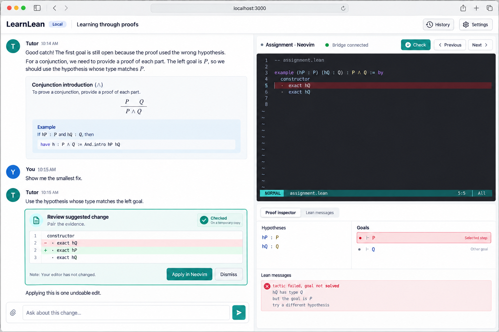
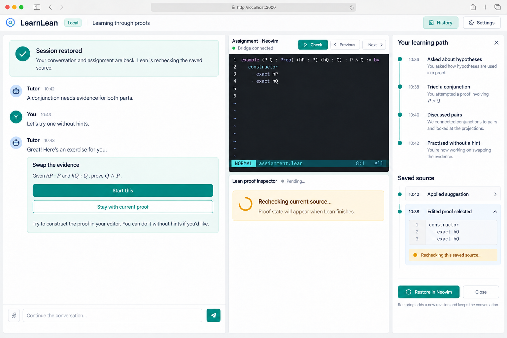

# LearnLean: MVP UX design

## Experience contract

The main experience is an interactive conversation. The tutor chooses which concept, example, or exercise to present based on the learner's goals and responses. Rich teaching materials appear within that conversation. Beside it, a real Neovim terminal and a Lean proof inspector let the learner act on and discuss the current assignment.

The graphical mockups show a local web application in a macOS browser. They are generated design concepts, not implemented screens. The written contracts below govern exact behavior and wording. Images and their [generation prompts](docs/mockups/PROMPTS.md) are stored in the repository.

## Workspace and visual direction

At desktop widths, chat takes approximately 55% of the workspace. The remaining space holds the editor terminal above the proof inspector. All dividers are resizable. The top bar provides the session name, local-runtime status, History, and Settings. There is no permanent course outline or chapter progression.

Use white conversation surfaces, subtle warm-gray backgrounds, restrained teal actions, and clear speaker labels. Rich content cards can contain mathematics, diagrams, references, and code. The terminal uses a legible dark palette and the editor's own status line. Application controls belong outside the terminal, so the learner can distinguish the host application from Neovim.

Before an assignment is active, chat can use most of the window. Activating an exercise opens the editor and inspector without moving the conversation to a secondary tab. At smaller desktop widths, allow switching between Chat and Workspace while keeping a compact active-assignment header. Phone editing is deferred.

## Mockup A: conversation first

The learner states an intention in ordinary language. The tutor asks only what it needs to choose a useful next step. An explanation card and an exercise appear directly in the dialogue; the learner does not have to browse a lesson catalog first.

A ready exercise has an “Open in editor” action. The tutor may open the first exercise automatically after the learner asks to practice. If another assignment is active, a new proposal stays in chat until the learner chooses it, unless the learner explicitly requested the switch. Switching preserves acknowledged buffers and offers a return link to the earlier assignment.

The composer offers optional actions such as “Explain differently,” “Give me a hint,” and “Something harder,” while accepting unrestricted text. These are conversational shortcuts, not a required learning sequence.

## Starting a local session

The intended `nix run .#learnlean` launch starts the local runtime and opens the browser UI. The first screen offers “Start a conversation” and recent sessions. Model configuration is requested only if no endpoint is configured; editing and Lean inspection remain usable without a model connection.

Settings contain the model endpoint, editor profile, terminal font/size, and local session location. Neovim is the default editor profile. Offer a bundled working configuration and an optional user configuration; report whether the integration bridge connected. Nix/tool versions are available in a details panel, not in the teaching conversation.

The opening message can be “What would you like to understand or prove?” Suggested starting points are optional. Resume restores the actual conversation and active assignment rather than generating a recap as though it were the original history.

## Rich teaching turns

A tutor turn can contain:

- A short explanation or a question asking the learner to reason.
- A referenced concept, example, or diagram from the material library.
- A proposed exercise with its statement, motivation, and “Open in editor” action.
- A source/goal anchor that focuses the editor or inspector when selected.
- A proposed source diff with review controls.
- A suggested next direction with alternatives.

Use an unobtrusive “From the material library” or “Tutor-created exercise” label in card details. The learner need not understand component IDs. New exercise cards show “Preparing exercise” until their statement and reference solution have been checked. A failed proposal leads to a brief explanation and a different exercise; it must not silently appear as a validated assignment.

The tutor can adjust difficulty, revisit prerequisites, or change representation. It must preserve the meaning of an active assignment: changing its statement creates a new assignment rather than moving the target while the learner is proving it.

## Mockup B: Neovim, a failing tactic, and a focused discussion

The terminal is interactive: Normal/Insert modes, motions, commands, search, splits, and undo behave as Neovim normally does. Clicking it focuses the editor. The app never interprets terminal text to guess the proof state; the Neovim extension sends structured source and position information.

The active-assignment bar identifies which buffer the inspector follows. Switching to another managed assignment buffer changes that anchor. Opening an unrelated file does not turn it into a new assignment; retain the previous inspector with a “Not the focused assignment buffer” label.

“Ask about this” can be invoked from the application or an editor command. It adds a visible context chip to the composer containing the assignment, revision, and selected step or range. The learner adds their question and sends it. This follows MathPub's pattern of turning visual feedback into precise source context.

### Recorded versus written

“Recorded” means a buffer change has reached the durable event log, even if the Neovim buffer has not been written with `:w`. Neovim's modified indicator still refers to its working file. A tooltip explains the distinction once: “Your edit is in session history; :w writes the working file.”

Normal editing is recorded after a short pause through the extension. “Recording…” remains visible until acknowledgement. Check, Send with source context, assignment switching, and normal shutdown first flush pending changes. Unacknowledged edits are not promised to survive a process crash.

The saved-file fallback for another editor is clearly labeled “Checks update on save.” It cannot claim live cursor or unsaved-buffer integration.

## Proof inspection and stepping

Source position is where the editor cursor is. Inspection position is the tactic boundary whose state is displayed. By default the inspector follows the cursor; “Pin step” holds the selected state. Previous/Next select meaningful tactic boundaries and ask Neovim to reveal the corresponding range without stealing focus from chat.

Stepping navigates states derived from the checked document. It does not execute terminal keystrokes, delete later source, or undo edits. Before/After and Compare expose the actual transition. Multiline tactics can be one step; unsupported macro internals remain composite steps.

Each inspector shows the assignment, selected step, before/after mode, and freshness. Hypotheses are labeled as available evidence; goals retain literal Lean notation. A proof can be complete while an earlier selected state still has two goals. Whole-assignment status and selected-step goals have separate labels.

An edit immediately marks old results stale. When Lean finishes checking the corresponding acknowledged revision, refresh the inspector. If the chosen tactic disappeared, move to a nearby valid boundary and announce that change. A failing tactic may have a valid before-state and no after-state. Show “After-state unavailable” instead of inventing one.

Keep raw Lean diagnostics visually separate from tutor explanations. The tutor can discuss source while checking is pending, but its turn must say when checked goal context was unavailable.

## Mockup C: the path adapts to the learner

A learner saying “I can copy this but don't understand it” changes the tutor's next action. The tutor may reuse a diagram, ask for a verbal prediction, then suggest a nearby exercise. It explains the choice briefly and offers alternatives.

The tutor acts after a learner message, a submitted attempt, or an explicit next-step request. It does not send a new teaching turn after every cursor movement or check. Successful checks produce application status; they do not force advancement. The learner can keep inspecting the same proof, ask a question, or request a challenge.

Provisional beliefs about understanding are revisable. Do not display an automatic mastery percentage. A session-history view records the materials actually discussed and assignments attempted; it is not a curriculum checklist.

## Mockup D: accepting an editor change

The tutor may suggest a tactic or a small patch. A patch is a rich chat card with an exact diff, explanation, base revision, and application-owned check status. “Checked on a temporary copy” applies to the proposal; the current buffer is unchanged.

“Apply in Neovim” flushes edits, verifies the base revision, and requests one undoable editor transaction. If the learner has typed since the suggestion was prepared, disable Apply and offer “Refresh suggestion.” Never silently rebase or replace the entire buffer.

A disconnected editor shows “Reconnect editor to apply.” A proposal can still be read and copied, but no UI should report an applied edit until the resulting source event is acknowledged. If the learner presses `u`, the undo becomes another recorded source change.

Help escalates from conceptual guidance to a tactic suggestion and then code. “Reveal solution” is an explicit conversational action, recorded in history. Lean checks the resulting proof regardless of who supplied the code; understanding remains a separate teaching question.

## Mockup E: recover a personal learning path

History lists the actual conversation, material presentations, assignment switches, and acknowledged source revisions. The learner can revisit an earlier explanation or preview an earlier source revision. A source restore creates a new revision and retains later conversation and work.

After a cold restart, source and transcript return first. Proof results show “Rechecking,” and a fresh Neovim process opens the recovered assignment. The app restores meaningful context, not the exact terminal screen, shell process, or editor undo tree from before shutdown.

A past tutor statement remains historical speech. Current “Checked” badges are recomputed and do not inherit their truth from the transcript. Old code suggestions retain their original source anchors and are inapplicable to a different revision until refreshed.

## Focus and keyboard behavior

Provide visible actions to focus Chat, Editor, and Inspector, with discoverable app shortcuts that avoid Neovim's normal keys. When the terminal has focus, ordinary editing keys go to the PTY. Do not globally capture Escape, `j`, `k`, Ctrl-W, or the editor's command keys.

Pinning a goal or asking a question should not move the editor cursor unexpectedly. “Reveal in editor” may scroll/highlight without taking focus; “Edit here” explicitly transfers focus. Terminal resizing updates both the renderer and PTY dimensions, including when a pane reopens after being hidden.

Support keyboard operation, resizable panes, high contrast, zoom, and reduced motion. Offer a linear accessible transcript and plain-text goals. The terminal's accessibility mode and Neovim combination must be tested with actual assistive technology; do not claim that a graphical terminal is automatically equivalent to a native text editor. An external-editor workflow is a later accessibility option, not an MVP substitute for testing.

## Failure and recovery states

| Situation | Visible behavior | Recovery |
| --- | --- | --- |
| Model unconfigured or unavailable | Chat setup/retry message; source and Lean still usable | Configure endpoint or explicitly retry |
| Neovim starts without bridge | “Editor connected; live integration unavailable” | Load the extension or use saved-file fallback |
| Pending buffer acknowledgement | “Recording…”; dependent operations wait | Retry the same source operation ID |
| Local service disconnects | Terminal/chat disconnected; no false “Recorded” label | Reconnect and reconcile buffer versus logged revision |
| Terminal/editor exits | Conversation and inspector stay visible | Restart Neovim from acknowledged source |
| Concurrent external file edit | Show buffer/log/file conflict without overwriting | Choose which source to import as a new revision |
| Lean is busy or fails | Pending/unavailable status, old results marked stale | Cancel or restart Lean; keep editing |
| Tutor proposes invalid exercise | Keep proposal pending and explain failure briefly | Retry within limits or choose a reviewed material |
| Source changes during a reply | “About an earlier revision” context chip | Ask again with current context |
| Old toolchain cannot be restored | Source/chat recovered; rechecking unavailable | Restore pinned Nix closure; do not silently upgrade |

These are local usability and data-recovery behaviors. Hosted-service isolation, account permissions, and security approval flows are deferred.

## UX acceptance scenarios

- Two different opening goals lead to different coherent material sequences, and the learner can redirect either path.
- A rich concept card appears inside chat, and its exercise opens in a genuine interactive Neovim terminal.
- Unsaved edits become acknowledged source history, update Lean, and anchor the next tutor question correctly.
- A selected proof step, whole-assignment result, and pending source edit are visibly distinguishable.
- A reviewed patch is applied through Neovim, undoable, and never overwrites a newer buffer.
- Selecting a new exercise preserves the prior assignment, its conversation anchors, and its source history.
- Wiping derived state recovers the actual learning path without issuing new model requests.
- A learner can complete, inspect, and restore an assignment when the model endpoint is unavailable.
