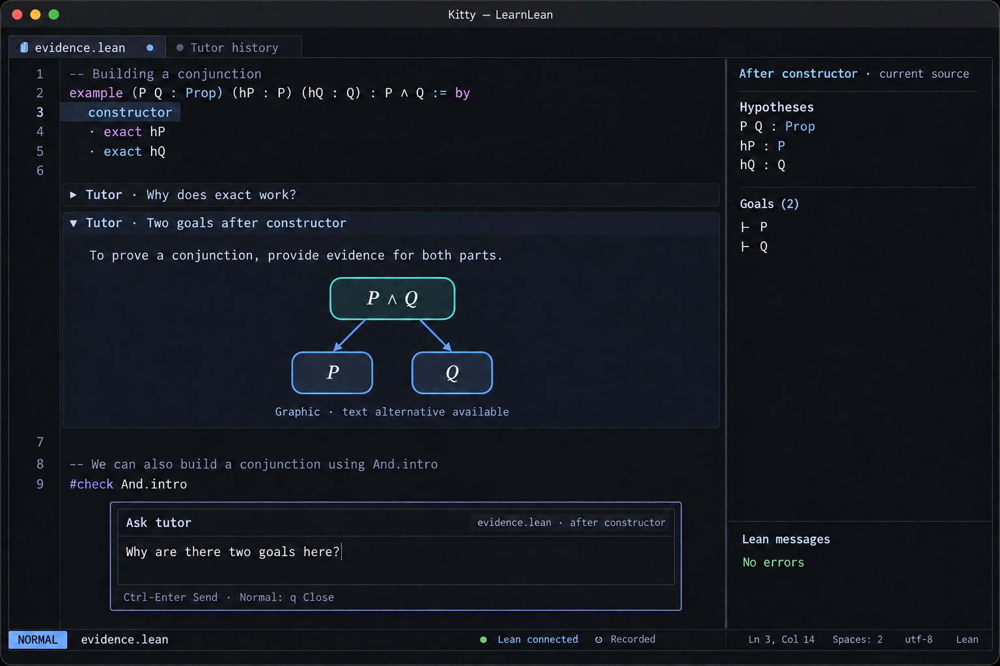

# Neovim as the learning environment

## Status and recommendation

**Alternative design for evaluation.** This document explores inverting the browser-led design in [MVP_UX_DESIGN.md](MVP_UX_DESIGN.md): Neovim becomes the application surface, with a local tutor service and prover integration behind it. It does not yet replace that design or claim a working prototype.

**Yes: ordinary proof files can be displayed with inline graphical elements in Neovim, given a supporting terminal and plugin.** The file remains text. A plugin associates an illustration with a source position, reserves screen space, and asks the terminal to draw it. Raw Kitty graphics escape sequences should not be stored in the proof file.

The recommended first version combines:

- Real `.lean` files edited normally in Neovim.
- A floating chat composer invoked on demand.
- A searchable, foldable transcript in an ordinary scratch buffer.
- Small, collapsible tutor annotations attached to proof positions, with optional inline graphics.
- An existing Lean infoview, followed by a separate Rocq/Coq adapter if this interaction model proves useful.

Kitty running Neovim directly is the initial graphical configuration. Text-only operation remains a complete learning experience. The local runtime, Nix packaging, adaptive tutor, and event-sourcing commitments remain in force.

## What exists today, and what still needs building

Research checked against primary project documentation on 2026-09-17. This is documentation-based feasibility analysis, not a tested compatibility matrix.

| Capability | Evidence | Remaining work for LearnLean |
| --- | --- | --- |
| Images alongside Neovim text | `image.nvim` documents Kitty rendering, window/buffer association, extmark anchoring, and virtual padding | Tutor-block lifecycle, placement policy, and integration testing |
| Graphical Lean infoview | `lean.nvim` documents inline ProofWidgets images and SVG rendering, with `resvg` for SVG | Determine reusable APIs and exact pinned-version behavior |
| Chat entry inside the editor | Neovim supports editable floating windows | Composer commands, context capture, streaming, and history |
| Foldable text | Neovim supports folds over buffer lines | Transcript fold structure and separate virtual-block collapse behavior |
| Interactive Rocq/Coq editing | Coqtail supports Neovim and proof interaction | A prover-specific context/completion adapter |

The [image.nvim API](https://github.com/3rd/image.nvim#api) exposes `from_file`, buffer/window bindings, `inline`, and `with_virtual_padding`. Its existence directly supports the proposed inline-image approach; it does not establish that our complete interaction model already works.

More specifically relevant, [lean.nvim](https://github.com/Julian/lean.nvim#optional-terminal-graphics) already documents terminal graphics for ProofWidgets, in addition to its goal and tactic-state infoview. Investigate this before building a second Lean UI. Its infoview graphics do not automatically provide arbitrary tutor graphics in a source buffer.

[Molten](https://github.com/benlubas/molten-nvim#images) is another precedent for Neovim outputs with images and virtual lines. It provides useful interaction evidence, but its Jupyter execution model is unnecessary for native Lean files.

## Proposed appearance



This image is a generated concept mockup, not a screenshot of a tested plugin. Its [generation prompt](docs/mockups/NVIM_PROMPT.md) is retained. Pixel-level layout, keybindings, and image behavior require the prototype below.

The proof file occupies most of the window. The infoview is a conventional split that can be closed, resized, or moved. Tutor blocks appear near the source they discuss, but do not take over typing. Older explanations collapse to one-line summaries. The learner invokes a chat dialog when they want to ask, redirect, request another exercise, or discuss a selection.

There is no required persistent chat pane. A transcript split is available when the learner wants a longer conversation or wants to search previous explanations. The tutor still chooses a personal learning path; moving the surface into Neovim does not reduce it to code completion.

## What “a normal file with graphics” means

There are three separate layers:

1. **Source:** actual UTF-8 `.lean` or `.v` bytes, readable by the prover and any editor.
2. **Annotations:** received tutor text, material references, source anchors, and optional graphic specifications stored in session events/original artifacts.
3. **Presentation:** Neovim text decorations and terminal image placements derived from those inputs.

Opening a file through the packaged LearnLean profile attaches its session annotations. Opening it without the plugin shows the original source and any explicitly saved comments, but no images. Compiling the file requires neither the plugin nor a terminal. A plain file copy does not carry the full conversation; an explicit session export includes that history and original graphic inputs.

### Recommended default: a plain proof file with view-only annotations

For example, the actual file may contain only:

```lean
example (P Q : Prop) (hP : P) (hQ : Q) : P ∧ Q := by
  constructor
  · exact hP
  · exact hQ
```

An expanded tutor block can appear visually below `constructor` without inserting source lines. The diagram and annotation rows have no file line numbers. Ordinary yanks and writes operate on source, not the rendered annotation. Provide “Copy explanation” and “Open in transcript” actions for annotation content.

This preserves ordinary parser/LSP coordinates and avoids rechecking source whenever a reply expands or collapses. Source line numbers need no adjustment for virtual screen rows; mouse/screen-to-source mapping still requires care.

### Optional: save an explanation or illustration reference as a comment

A learner may choose “Keep in source” to add useful original explanation text and a material reference:

```lean
-- @learnlean block conjunction-intro
-- Tutor: Proving a conjunction requires evidence for both parts.
-- Illustration: conjunction-intro; alt: one goal splits into P and Q.
example (P Q : Prop) (hP : P) (hQ : Q) : P ∧ Q := by
  constructor
  · exact hP
  · exact hQ
```

These are ordinary Lean comments. The plugin can resolve the illustration reference and render a graphic at that anchor. Without the plugin, the explanation and text alternative remain readable. The marker format is proposed, not an existing standard.

Saving a reply in source is an explicit, undoable edit with comment escaping appropriate to the language. For Rocq, use valid `(* ... *)` comments and handle embedded delimiters. Preserve a reference to the original received reply when recording the action. Do not automatically serialize goals, diagnostics, current grades, or terminal graphics into source comments.

This mode can use native folds because the explanation has real buffer lines. It incurs actual source edits and may trigger prover work; use it for durable notes rather than every conversational turn.

### Do not store terminal protocol sequences in source

Kitty graphics are a terminal rendering protocol, not a proof-language or Markdown format. A raw file containing its control sequences is not a portable inline-image document, and Neovim does not simply execute arbitrary file bytes as terminal commands when opening it. Store graphic source/references separately or as readable comment metadata; the renderer emits the terminal commands.

Kitty also defines Unicode image placeholders associated with uploaded image data. These can help image placements move with terminal text, but the placeholder characters alone do not contain the image. If used by our renderer, keep them in its display machinery rather than saved proof source. See the [Kitty graphics protocol](https://sw.kovidgoyal.net/kitty/graphics-protocol/#unicode-placeholders).

## The two primary actions

### 1. Ask the tutor

Invoke a proposed `:LearnAsk` command, optionally with a visual selection. It opens an editable floating scratch buffer. The header shows the captured file/revision and selected proof position; the user can remove that context and ask a general question.

Enter inserts a newline. An explicit Send command/mapping submits the text. A possible default is Ctrl-Enter where the terminal supports it, with a portable Normal-mode `<leader>ls` alternative. Escape leaves Insert mode as usual; a subsequent Normal-mode close action dismisses the composer. Do not assume every terminal distinguishes modified Enter keys.

Closing retains the draft for the live session. Sending first records pending source edits, then anchors the question to that acknowledged revision. If the user keeps editing while the model responds, the reply retains its original context and can be labeled “About an earlier revision.”

A response appears in the transcript. At the requested source anchor, show a compact annotation header that can expand to text or graphics. Streaming updates do not repeatedly resize the proof window: stream in the transcript/composer area, then offer the completed inline block.

The tutor can choose a library component, present an exercise, ask a prediction question, or propose new validated material. A new exercise opens as a normal file/buffer after the learner asks for it or accepts the proposal. Existing buffers remain intact.

### 2. Edit the proof normally

Typing, motions, search, selections, undo, and `:write` retain their meaning. The prover integration processes source according to its native document model. No chat message is necessary to check an edit.

The infoview follows the selected position, with an option to pin it. Inline tutor annotations do not become prover input. Continuous checking does not trigger a tutor turn after every edit; “Explain this,” “Hint,” and deliberate attempt submission are explicit conversational triggers.

Patch suggestions use a scratch diff view. Acceptance verifies the current buffer revision and applies one undoable change. A changed buffer invalidates the proposal rather than inviting a silent rebase. Check results remain tied to the exact source checked.

## Foldable blocks: a necessary distinction

Neovim folds operate over real buffer lines. They do not automatically turn arbitrary virtual lines or images into independently foldable objects. [Neovim's folding documentation](https://neovim.io/doc/user/fold/) describes the native mechanism; [its API documentation](https://neovim.io/doc/user/api) provides extmarks, virtual lines, and floating windows as separate primitives.

Use three explicit behaviors:

| Surface | Behavior |
| --- | --- |
| Transcript scratch buffer | Replies occupy real lines, so ordinary `za`, `zo`, and `zc` can control native folds |
| Saved source comments | Can participate in normal source/comment folds without inventing hidden file content |
| View-only source annotations | `:LearnFold` / `:LearnUnfold` controls the plugin's own block state; expanding adds virtual rows/placements, collapsing removes them |

Do not globally replace Neovim's fold commands or take over a user's existing proof-code fold configuration. A later contextual mapping can delegate `za` when the cursor is explicitly on an annotation control, but it must leave code folds predictable.

Virtual annotation text is not normally an editable, searchable text range. Long replies should therefore open in the transcript buffer, where normal search, selection, copying, and folds work. Graphics always have text alternatives there. This is why a transcript buffer remains useful even in a file-centred UI.

## Rendering design and risks

Proposed rendering pipeline:

1. A tutor response references a library illustration, supplies a small declarative diagram, or includes an external image input.
2. Resolve the original input and text alternative; derive a raster at the required size using pinned tooling such as `resvg` for SVG.
3. Associate the block with a revision-scoped source range and create a Neovim extmark for live tracking.
4. Reserve display rows through virtual padding and bind an image placement to the particular buffer/window.
5. Clear/reposition placements when visibility, layout, folding, or window ownership changes.

Prefer the image library's maintained layout machinery over writing graphics escape handling ourselves. The exact choice between `image.nvim` and extracting/reusing `lean.nvim` graphics support remains a prototype decision; do not run two uncoordinated renderers over the same placements.

Screen placement must consider wrapped lines, horizontal scroll, narrow splits, font changes, multiple windows showing the same buffer, and partial image visibility. Images also need to disappear behind the chat composer, completion menu, or another overlapping window. If a selected renderer cannot handle occlusion reliably, clear images while an overlay is open and restore them afterward.

An extmark tracks text movement; it does not prove that a reply still describes the edited code. Store the original revision/range in the event history. Reattach on replay using the source history and, where helpful, declaration identity. If the anchor was removed or changed ambiguously, move the block to transcript-only with a stale-anchor label. Never attach advice to a nearby but unrelated proof silently.

Native source folding should hide any annotation/image whose anchor is inside the hidden range. Folding the tutor block hides its image and padding independently of source folds. These interactions must be demonstrated; a static mockup is not evidence they work.

### Initial compatibility policy

| Environment | Initial position |
| --- | --- |
| Pinned Kitty + Neovim, local, direct terminal | Graphical prototype target |
| Another Kitty-protocol terminal | Text works; graphics require a tested capability combination |
| tmux/screen, SSH, nested terminals | Defer graphics certification; provide text fallback |
| Neovim GUI such as Neovide | Text-first; terminal graphics support cannot be assumed |
| Previous browser/xterm-based host | Separate design; do not assume the same graphics path works |

Probe graphics support through the chosen library/backend and expose a `:LearnHealth` report. Terminal names or `$TERM` alone are not sufficient evidence. Rendering failures should collapse to a labeled text alternative and an “Open image” action, not disrupt proof editing.

## Lean first; Rocq/Coq as a separate adapter

For this alternative, prefer letting **Neovim's existing prover integration own the live prover connection**, instead of retaining the browser design's service-owned Lean LSP. LearnLean observes source revisions, asks the integration for position-scoped context, and provides tutor/history functionality. This change is intentional: there must be one owner per buffer, not competing language-server clients.

Prototype with pinned `lean.nvim`. Inspect its supported extension points before relying on internal functions; add a small versioned adapter if necessary. The LSP can process a live buffer before its event acknowledgement, but tutor context and application-owned status must wait for a matching recorded revision. Temporary reference-solution checks may use a separate checker process without taking over the editing document.

Expose a capability-based prover interface:

- Identify document version, environment, and current processing status.
- Obtain goals, hypotheses, diagnostics, and source ranges at an explicit position.
- Reveal supported proof boundaries or process-to-position operations.
- Check a submitted target against the assignment's completion rules.

Lean's navigation through elaborated tactic states and a Rocq session's processing/rewinding operations are not interchangeable. The UI must preserve that distinction rather than offer a fictional universal “execute next line.”

[Coqtail](https://github.com/whonore/Coqtail) is a concrete Neovim-capable Rocq/Coq integration to investigate. Its prover transport and processing model need a separate adapter, and other Rocq language-server integrations may be alternatives. Full Rocq support is a follow-on feasibility track, not an MVP promise inferred from changing a file extension. Completion checks must account for admitted proofs/assumptions using that prover's own semantics.

## Normal files and the event-sourcing contract

Unlike the earlier scratch-workspace design, this alternative treats the user's ordinary `.lean`/`.v` file as a durable authored source document. It is an original input, not a calculated projection. The event log remains authoritative for **recorded session history**, while the editor/file can introduce new source inputs that must be reconciled.

At attachment, compare the actual file/buffer with the last recorded source. Import new user edits as input events after resolving conflicts; do not overwrite an existing file with a replayed view. `:write` writes ordinary source. “Recorded” separately confirms that buffer input was appended to the session log. Restoring an earlier revision is an explicit undoable source edit, followed by normal recording and optional file writing.

Durable state consists of original source changes, learner questions, received tutor content, actual material/assignment actions, original image/diagram inputs, and pinned environment references. A received external image is an original input. A PNG rasterized from retained SVG, terminal image IDs, generated thumbnails, virtual padding, goals, diagnostics, and mastery estimates are disposable projections.

The transcript scratch buffer and source annotations are rebuilt from events. Native buffer numbers, extmark IDs, image-placement IDs, and screen coordinates are never durable anchors. Persist deliberate block visibility preferences only as user choices; do not save rendered layout snapshots.

Cold recovery opens the original/reconciled source, reconstructs conversation, starts the prover, rerenders visible illustrations, and shows “Rechecking.” It does not replay terminal escape sequences or regenerate model responses. No hidden calculated results are written into comments for convenience.

## Local packaging

Keep the local tutor/event service and SQLite log. Replace the browser frontend and application-managed PTY with a Lua plugin running in the user's Neovim. It communicates with the service over a local socket; Neovim runs directly in the terminal supplied by the user or a packaged launcher.

Proposed future entry points:

```console
nix run .#learnlean-nvim -- path/to/evidence.lean
nix run .#learnlean-kitty -- path/to/evidence.lean
```

The first runs the pinned editor/profile in the current terminal, with text fallback. The second launches the pinned Kitty/editor stack for the tested graphical experience. These commands are design proposals; neither flake output exists yet.

Pin the editor, Lean integration, Lean/Lake, graphics plugin, rasterizer, Lua dependencies, service, and optional Kitty launcher. Preserve user-configuration choice, but distinguish the supported packaged profile from a custom profile. Investigate compatibility with existing folds, diagnostic configuration, and mappings before claiming arbitrary configuration support.

Execution stays local and trusted as requested. No hosted security-boundary work is introduced. A remote or local model endpoint remains configurable independently of the editor surface.

## Prototype that would decide the design

Build a small spike before committing to the inversion:

1. Open a real `.lean` file in pinned Kitty/Neovim with `lean.nvim`; verify checking and infoview navigation without LearnLean UI.
2. Add a floating multi-line composer and a deterministic fixture reply in a native-folding transcript buffer.
3. Attach one text block and one generated diagram to a source extmark without changing any file bytes.
4. Demonstrate collapse/expand, scroll, wrap, split resize, source folds, floating-window overlap, two views of one buffer, and buffer close/reopen without orphaned images.
5. Edit above and inside the anchor, undo/redo, and verify correct positions or explicit stale-anchor fallback.
6. Confirm that `:write`, a source yank, and standalone Lean processing contain only ordinary source/comments, never renderer data.
7. Record the conversation and edits, wipe projections, restart, and recover the same content with newly allocated placements and fresh Lean checks.
8. Repeat without graphics support: all explanations and proof operations must still be available.

Only after this passes, connect a live model and adaptive material selection. Run a separate Rocq spike if that backend is needed.

**Decision gate:** proceed with Neovim as the primary UI if the normal editing loop remains predictable and the diagram survives layout changes reliably. If source-buffer images remain fragile, ship the same editor-led design with foldable text and graphics in a dedicated Neovim preview split; do not make inline images a prerequisite for useful tutoring.
