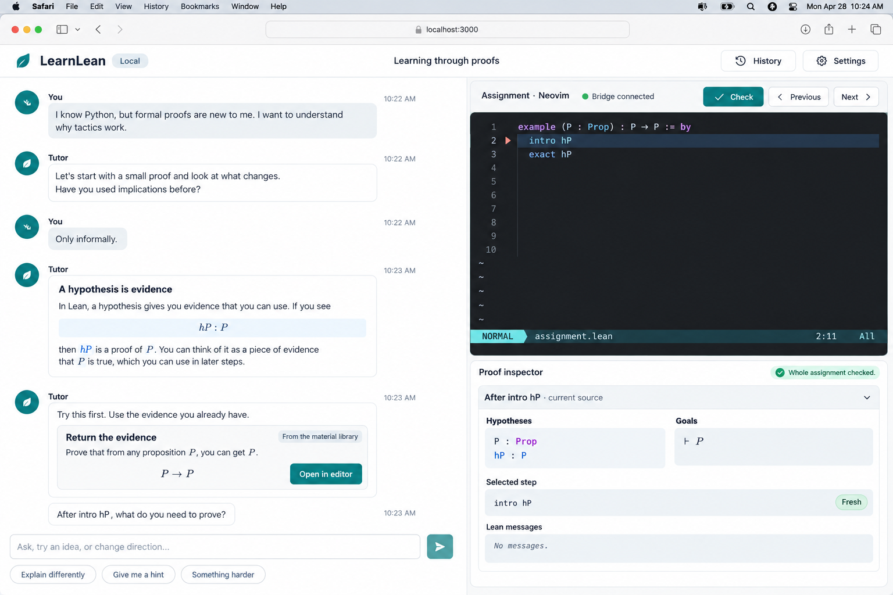

# LearnLean

A local, conversational environment for learning Lean 4. An LLM tutor shapes a personal learning path, presents concepts and exercises inside the dialogue, and helps the learner inspect real Lean proof states while working in their preferred editor.

**Current implementation: a Neovim-first Rocq prototype with a file-writing Codex tutor.** The copied Software Foundations LF book runs with the existing Rocq/Coqtail setup, extended with folded documentation and live graphical previews in Kitty. Open a comment, edit its plain text, and its preview updates without saving.

```sh
nix run . -- lf/Basics.v
```

This runs in your current Kitty terminal or tmux pane. Use `zo` to edit documentation, `zc` to collapse it, and `Space c j` to check the next Rocq sentence. See the [prototype guide](prototype/README.md) for setup, controls, implementation, and limitations. Validate with `nix flake check`.

Use **Space t a** or `:TutorAsk` to ask the tutor for explanations, exercises, or critiques. It edits and saves the current `.v` or `.lean` file using your existing Codex CLI login. See the [tutor guide](prototype/TUTOR.md). Graphical previews and prover integration currently support Rocq.

The broader learning environment below remains an earlier design proposal. The implemented tutor uses the proof file as the sole durable course record, with no additional session metadata.

## The experience

Start with a question or a learning goal: “I can program, but I don't understand proofs.” The tutor chooses a small exercise, presents it in chat, and opens the assignment in an embedded Neovim terminal. Edit normally, inspect hypotheses and goals at a selected proof step, and discuss the result. The tutor can offer a different explanation, revisit a prerequisite, or introduce a new challenge based on that exchange.

Rich concept cards, diagrams, worked examples, and assignments are part of the conversation. A library of reusable materials gives the tutor reliable starting points; the dialogue determines their order and presentation. There is no required chapter sequence.



## Proposed MVP

- A rich chat interface with an LLM that actively guides a unique path for each learner.
- A small material library covering hypotheses, implication, conjunction, equality, and induction, with room for tutor-proposed exercises.
- A real terminal hosting Neovim, integrated through a versioned extension protocol for unsaved buffers, cursor positions, and reviewed changes.
- Synchronized proof-step navigation, hypotheses, goals, and Lean diagnostics.
- Local session history, recoverable assignments, and explicit acceptance of suggested edits.
- A Nix flake pinning the application, Lean, Neovim, extension, and dependencies.
- An event-sourced local core: durable original inputs and received LLM responses; disposable calculated state.

The initial application is a browser UI served by a local process on the learner's device. A native desktop wrapper can follow. The model endpoint is configurable: a remote provider or an already available local endpoint. Local inference is not a launch requirement.

## Future application launch contract

Once implemented, a checkout with its committed lock file should support:

```console
nix run .#learnlean
nix develop
nix flake check
```

The launcher will start the local service, open the UI, and launch the pinned Neovim with its integration. No separate database service or Lean/editor installation should be required. Nix itself and a configured model endpoint are prerequisites; first launch may fetch or build dependencies.

## Design documents

| Document | Purpose |
| --- | --- |
| [VISION.md](VISION.md) | Conversational learning, learner agency, scope, and success criteria |
| [MVP_UX_DESIGN.md](MVP_UX_DESIGN.md) | Chat-led flows, graphical mockups, terminal interaction, and recovery |
| [MVP_TECHNICAL_DESIGN.md](MVP_TECHNICAL_DESIGN.md) | Local runtime, Nix packaging, editor protocol, Lean integration, and event replay |
| [NVIM_EMBEDDED_UX.md](NVIM_EMBEDDED_UX.md) | Alternative: Neovim as the primary interface, foldable tutoring, inline terminal graphics, and normal proof files |

The Neovim-first direction is now being explored through the Rocq prototype. That document contains the earlier graphical concept and feasibility research; the browser-led design remains available for comparison.

## Commitments

1. The tutor chooses teaching actions; the learner can redirect the conversation or keep working independently.
2. Lean results belong to an exact assignment, source revision, and toolchain. Tutor prose remains distinguishable from those results.
3. A suggestion changes the learner's buffer only after acceptance and is undoable in their editor.
4. Original source inputs, received model content, and enacted teaching choices are durable. Calculated goals, progress, and inferred learner profiles are rebuilt.
5. Terminal rendering is not session state. Deleting projections and runtime files must leave acknowledged source and conversation recoverable.
6. The MVP trusts the local operator and runs ordinary local processes. Hosted execution, multi-user isolation, and security hardening are deferred.

## Inspiration

The nearby [MathPub agentic vision](../mathpub/AGENTIC_VISION.md) and [workspace design](../mathpub/GUI_DESIGN.md) inspire a conversation that operates real tools alongside a live visual view. Its [component model](../mathpub/COMPONENT_LEXICON_DESIGN.md) suggests reusable teaching materials with stable identities. These are local reference links, not runtime dependencies. Software Foundations remains a pedagogical influence, rather than the organizing interface.
